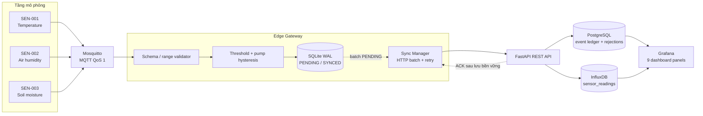
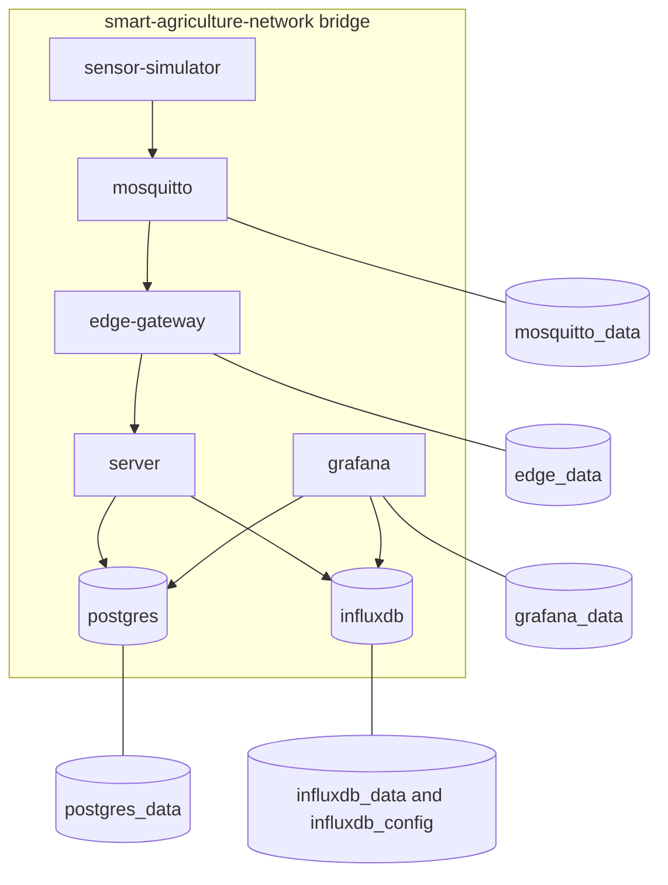

# Kiến trúc hệ thống

Smart Agriculture là hệ thống IoT nhiều tầng. Ba sensor tạo telemetry; Mosquitto chuyển bản tin MQTT QoS 1; Edge Gateway kiểm tra, ghi SQLite và xử lý cảnh báo/điều khiển tại chỗ. Sync Manager chuyển các bản ghi đã commit lên FastAPI. Server ghi event ledger vào PostgreSQL, ghi time-series vào InfluxDB rồi mới ACK. Grafana đọc hai kho dữ liệu.

## Quy tắc chịu lỗi

- Edge cần Mosquitto để nhận sensor, nhưng không phụ thuộc Server để khởi động hoặc ghi SQLite.
- MQTT dùng manual ACK: Edge chỉ ACK broker sau khi xử lý cục bộ thành công. Nếu SQLite lỗi, message không được ACK.
- SQLite bật WAL và synchronous FULL; telemetry, cảnh báo và hành động pump commit cùng transaction.
- Khi Server mất kết nối, dữ liệu giữ PENDING; retry HTTP dùng exponential backoff và batch tối đa 1.000 event.
- Server chỉ ACK khi event đã STORED trong PostgreSQL và InfluxDB, hoặc là duplicate khớp chính xác.

## Triển khai Compose

Các service nằm trên bridge network smart-agriculture-network. Named volumes giữ SQLite Edge, PostgreSQL, InfluxDB, Grafana và Mosquitto khi container restart. Simulator chờ Edge và broker healthy; Edge chỉ phụ thuộc broker. Xem [deployment guide](deployment-guide.md).

### Sơ đồ triển khai

## Interfaces

- MQTT topics: farm/sensors/temperature, farm/sensors/humidity, farm/sensors/soil_moisture.
- Server API base: /api/v1; Swagger UI: /docs.
- Influx bucket: smart_agriculture; measurement: sensor_readings.
- Grafana dashboard: Smart Agriculture Monitoring Dashboard.
