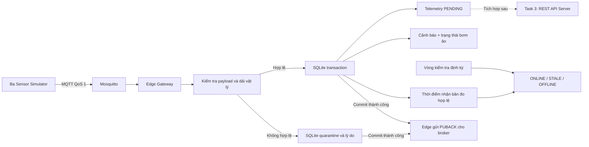

# Task 2.1 — Edge Gateway độc lập với Server

## Phạm vi và kiến trúc

Edge dùng SQLite có sẵn trong Python để giữ bản đo trên ổ đĩa, thay vì chỉ in terminal. Threshold engine tạo cảnh báo và điều khiển trạng thái bơm ảo cục bộ. Không cần FastAPI, PostgreSQL hoặc InfluxDB để thực hiện các việc này.



Đây là Task 2.1: nhận → kiểm tra/phân loại → lưu → xử lý và theo dõi cảm biến khi Server không hoạt động. Chưa có sync manager HTTP; bản đo hợp lệ được giữ `PENDING`. Buffer đã có hàm cập nhật `SYNCED` sau ACK Server để tích hợp bước tiếp theo, không tự xác nhận đồng bộ.

## File và bảng dữ liệu

| File | Vai trò |
|---|---|
| `edge-gateway/main.py` | Chạy Edge hoặc đọc trạng thái SQLite |
| `edge-gateway/mqtt_client.py` | Subscribe QoS 1, xác nhận sau commit, tự reconnect |
| `edge-gateway/data_validator.py` | Kiểm tra schema, định danh, timestamp, dải đo |
| `edge-gateway/buffer_manager.py` | Transaction SQLite, chống trùng, dữ liệu chờ đồng bộ |
| `edge-gateway/threshold_engine.py` | Cảnh báo nhiệt độ cao, độ ẩm thấp |
| `edge-gateway/device_controller.py` | Hysteresis của bơm ảo |
| `edge-gateway/sensor_health.py` | ONLINE/STALE/OFFLINE theo thời gian Edge nhận dữ liệu |
| `edge-gateway/edge_config.yaml` | Ngưỡng và giới hạn có thể thay đổi |
| `edge-gateway/edge.db` | Database runtime được tạo tự động, bỏ qua trong Git |
| `sensor-simulator/edge_demo.py` | Dữ liệu cố định để nghiệm thu |
| `tests/test_edge.py` | Kiểm thử Edge và chạy thực qua MQTT |
| `tests/test_sensor_health.py` | Trạng thái, im lặng MQTT, phục hồi và timer định kỳ |
| `tests/test_buffer_sync.py` | Phân loại, nâng cấp database và quản lý ACK/PENDING/SYNCED |

Edge dùng lại JSON schema và registry cảm biến của Task 1 trong `sensor-simulator/`; giữ nguyên cấu trúc repository khi chạy. Thư viện Paho, PyYAML và jsonschema đã có trong môi trường Task 2; `sqlite3` thuộc thư viện chuẩn Python.

Database mặc định: `edge-gateway/edge.db`, đúng vị trí bàn giao Task 2.1; được tạo khi chạy Edge và không đưa vào Git. File WAL/SHM đi kèm cũng được bỏ qua. Nếu đã có database cũ `data/edge.db`, chạy `--db data/edge.db` để tiếp tục dùng; chương trình không tự di chuyển hoặc xóa database cũ.

| Bảng | Nội dung |
|---|---|
| `telemetry` | Sáu trường gốc, topic, payload, received_at, processed_at, control_applied, classification, sync_status và synced_at |
| `alerts` | Cảnh báo, event_id nguồn, giá trị và ngưỡng |
| `device_state` | Trạng thái bơm ảo hiện tại; được khôi phục khi khởi động lại |
| `device_actions` | Lịch sử chuyển ON/OFF, liên kết event_id |
| `sensor_watermarks` | Thời điểm/sequence mới nhất để tránh điều khiển bằng dữ liệu đến ngược thứ tự |
| `quarantine` | Payload sai dạng BLOB, topic, lý do, thời điểm nhận, classification=INVALID |
| `sensor_health` | Trạng thái và last_received_at riêng cho ba cảm biến |
| `sensor_health_events` | Lịch sử chuyển trạng thái, lý do và thời điểm |

`telemetry.event_id` là PRIMARY KEY. Cùng event_id và payload là `DUPLICATE`; không thêm bản đo/cảnh báo hay lặp thao tác bơm. Dùng lại event_id với payload khác bị quarantine, không ghi đè bản gốc.

Schema được nâng cấp tại chỗ khi khởi động Edge: bổ sung các bảng/cột còn thiếu, giữ nguyên dữ liệu PENDING/SYNCED. Classification của bản đo cũ được điền một lần theo ngưỡng hiện tại; đây không phải phép tái tạo cấu hình ngưỡng trong quá khứ.

## Chạy trên PowerShell

Từ `E:\IoT-Agriculture`; giữ Docker Desktop chạy. Các lệnh dùng Python trong `.venv`, không cần kích hoạt lại terminal.

```powershell
.\.venv\Scripts\python.exe -m pip install -r edge-gateway/requirements.txt
docker compose -f infrastructure/docker-compose.yml up -d --wait mosquitto
```

**Terminal 1 — chạy Edge trước:**

```powershell
.\.venv\Scripts\python.exe edge-gateway/main.py
```

Mong đợi:

```text
EDGE MQTT SUBSCRIBED three topics qos=1; SQLite ready; Server not required
```

**Terminal 2 — chạy ba cảm biến bình thường:**

```powershell
.\.venv\Scripts\python.exe sensor-simulator/main.py --interval 2 --count 3
```

**Terminal 3 — xem bằng chứng đã lưu:**

```powershell
.\.venv\Scripts\python.exe edge-gateway/main.py --status
```

Nếu database mới và không có publisher khác, `total=9`, `pending=9`, `synced=0`. Các số này là số tích lũy trong SQLite, không phải số dòng terminal. Nếu đã có dữ liệu từ lần trước thì so sánh mức tăng thay vì giá trị tuyệt đối.

Trên Linux, kích hoạt virtual environment rồi dùng `python` thay cho `.\.venv\Scripts\python.exe`.

## Demo ngưỡng, bơm, bản tin sai và chống trùng

Dừng publisher thường bằng Ctrl+C. Giữ broker hoạt động. Để đếm chính xác trên database riêng, dừng Edge cũ và khởi động:

```powershell
# Terminal 1; chọn tên DB chưa dùng nếu muốn bắt đầu từ 0.
.\.venv\Scripts\python.exe edge-gateway/main.py --db data/edge-demo.db

# Terminal 2
.\.venv\Scripts\python.exe sensor-simulator/edge_demo.py --interval 2

# Terminal 3, có thể chạy nhiều lần trong lúc demo
.\.venv\Scripts\python.exe edge-gateway/main.py --db data/edge-demo.db --status
```

Không chạy hai Edge cùng client ID `farm-edge-001`: broker sẽ ngắt client cũ. Chỉ cần một Edge cho demo. Nếu thực sự chạy các Edge riêng, dùng `--client-id` riêng và `--db` riêng.

| Đầu vào lần lượt | Kết quả tại Edge |
|---|---|
| Temperature 40°C | Lưu PENDING, cảnh báo HIGH_TEMPERATURE |
| Humidity 35% | Lưu PENDING, cảnh báo LOW_HUMIDITY |
| Soil moisture 20% | Lưu PENDING, bơm ON |
| Soil moisture 32% | Lưu PENDING, giữ bơm ON |
| Soil moisture 40% | Lưu PENDING, bơm OFF |
| Humidity 150% | Ngoài dải vật lý, lưu quarantine kèm lý do |
| Gửi lại event_id đầu tiên, cùng payload | DUPLICATE, không thêm cảnh báo hoặc bản đo |

Trên database mới, không có publisher khác, sau demo:

```json
{
  "total": 5,
  "pending": 5,
  "synced": 0,
  "alerts": 2,
  "quarantined": 1,
  "device_actions": 2,
  "classifications": {"ANOMALY": 3, "NORMAL": 2},
  "pump": {"state": "OFF"}
}
```

Đây là phần trích của kết quả `--status`. Kết quả thực còn có đường dẫn DB, event_id nguồn, thời điểm, sensor_health, recent_health_events và các cảnh báo/hành động gần nhất. Chạy demo lần nữa sẽ thêm 5 bản đo hợp lệ, 2 cảnh báo, 1 quarantine và 2 lần chuyển bơm; event_id của mỗi lần chạy mới là khác nhau.

## Phân loại dữ liệu

| Classification | Ý nghĩa | Ví dụ | Lưu ở đâu |
|---|---|---|---|
| `NORMAL` | Hợp lệ, nằm trong normal_ranges và không vi phạm ngưỡng cảnh báo/khô đất | Temperature 29.5°C, humidity 70%, soil 40% | `telemetry`, mặc định PENDING |
| `ANOMALY` | Hợp lệ nhưng ngoài normal_ranges hoặc vượt ngưỡng nghiệp vụ | Temperature -4°C/40°C, humidity 35%/98%, soil 20%/90% | `telemetry`, vẫn PENDING; áp dụng ngưỡng cảnh báo/điều khiển đã cấu hình khi bản đo còn mới |
| `INVALID` | Sai cấu trúc/định danh/thời gian/dải vật lý hoặc retained | JSON hỏng, humidity 150% | `quarantine`, kèm lý do |

Soil >35% là điều kiện tắt bơm, không tự được coi là bất thường. `normal_ranges` mặc định là temperature [20,40]°C, humidity [40,95]%, soil [30,80]%, theo dải mô phỏng Task 1; `valid_ranges` là giới hạn vật lý rộng hơn. Giá trị ngoài normal_ranges vẫn được lưu nếu hợp lệ. Ví dụ -4°C được phân loại ANOMALY nhưng không tạo HIGH_TEMPERATURE vì không vượt 35°C. Classification là metadata của Edge; payload gốc sáu trường gửi Server không bị thêm trường.

## Sensor Health Monitor và demo mất dữ liệu

Trong `edge_config.yaml`:

```yaml
sensor_health:
  stale_after_seconds: 30
  offline_after_seconds: 60
  check_interval_seconds: 1
```

- `ONLINE`: nhận bản đo hợp lệ mới trong vòng dưới 30 giây.
- `STALE`: từ 30 đến dưới 60 giây không nhận bản đo hợp lệ mới.
- `OFFLINE`: từ 60 giây trở lên không nhận bản đo hợp lệ mới.
- Cảm biến chưa từng gửi bắt đầu ở STALE, không báo ONLINE giả; chuyển OFFLINE sau 60 giây tính từ khi được theo dõi lần đầu trong database.

Vòng kiểm tra chạy độc lập với callback MQTT, nên vẫn phát hiện im lặng khi không có bản tin nào tới. Log chuyển trạng thái xuất hiện một lần cho mỗi lần đổi trạng thái, đồng thời lưu lịch sử vào SQLite. Khi bản đo mới hợp lệ đến, cảm biến phục hồi ONLINE ngay.

Health dùng thời điểm **Edge nhận dữ liệu**, không dùng timestamp gốc. Bản tin trùng event_id, dữ liệu lỗi hoặc retained không gia hạn ONLINE. Bản đo hợp lệ đến chậm vẫn thể hiện đường truyền đang có dữ liệu, nhưng cơ chế `control_max_age_seconds` ngăn điều khiển theo bản đo cũ. ONLINE là trạng thái nhận dữ liệu hợp lệ, không phải bằng chứng chắc chắn về phần cứng cảm biến thực.

Để demo nhanh, mặc định chờ 30/60 giây. Có thể tạo file YAML cấu hình riêng từ `edge_config.yaml`, đổi ba giá trị thành 5, 10, 0.5 rồi chạy Edge với `--config đường-dẫn-file.yaml`; chu kỳ gửi cảm biến nên là 1–2 giây.

**Demo một cảm biến ngừng gửi, hai cảm biến còn lại vẫn ONLINE:**

1. Giữ Edge và Mosquitto chạy. Dừng các publisher khác.
2. Mở ba terminal publisher riêng:

```powershell
.\.venv\Scripts\python.exe sensor-simulator/main.py --sensor temperature --interval 2
.\.venv\Scripts\python.exe sensor-simulator/main.py --sensor humidity --interval 2
.\.venv\Scripts\python.exe sensor-simulator/main.py --sensor soil_moisture --interval 2
```

3. Chờ Edge nhận đủ ba cảm biến. Chạy `python edge-gateway/main.py --status` để thấy ba dòng ONLINE.
4. Ctrl+C chỉ ở terminal humidity. Không dừng Edge hay broker.
5. Sau 30 giây kể từ bản đo humidity cuối, thấy log `sensor_id=SEN-002 ... state=STALE`; sau 60 giây thấy `state=OFFLINE`. Hai cảm biến còn lại tiếp tục nhận và ONLINE.
6. Chạy lại publisher humidity: thấy `previous=OFFLINE state=ONLINE` và `last_received_at` được cập nhật.

Nếu Edge dùng `--db` riêng thì lệnh `--status` phải dùng cùng `--db`. Nếu chính broker mất kết nối thì cả ba cảm biến có thể STALE/OFFLINE vì Edge không nhận được dữ liệu; trạng thái này không tự phân biệt lỗi broker và lỗi cảm biến.

Trạng thái/lần nhận cuối được lưu và khôi phục khi Edge khởi động lại, rồi được đánh giá lại theo giờ hiện tại. `--status` hiển thị trạng thái đã lưu lần gần nhất; nếu Edge đã dừng thì không có timer tiếp tục cập nhật trạng thái.

## Quản lý PENDING/SYNCED để tích hợp Task 3

Buffer có đủ API cục bộ, không cần một Server đang chạy:

```python
batch = buffer.pending_batch(limit=100)  # chỉ đọc; không đổi trạng thái
sent_ids = [event["event_id"] for event in batch]

# Sau khi sync worker đã nhận và kiểm tra ACK lưu bền vững từ Server:
updated = buffer.mark_synced(
    acknowledged_event_ids,  # chỉ event_id được xác nhận accepted/duplicate bền vững
    sent_event_ids=sent_ids,
)
```

`mark_synced` kiểm tra danh sách ID, chỉ cho phép ACK thuộc batch đã gửi và tồn tại tại Edge, cập nhật trạng thái và synced_at trong một transaction. Gọi lại cùng ACK không tạo tác động lặp và không thay thời điểm ACK đầu tiên. ACK một phần chỉ cập nhật phần được xác nhận; phần còn lại vẫn PENDING. ACK sai/ID không tồn tại khiến toàn bộ thao tác bị từ chối.

Timeout, lỗi HTTP, phản hồi sai hoặc chưa có ACK thì không gọi `mark_synced`. Chỉ số accepted/duplicates tổng cộng hoặc HTTP 200 không đủ để xác định các ID đã lưu nếu batch có xử lý một phần. Task 3 cần thống nhất response với danh sách ID được lưu bền vững hoặc giao thức ACK toàn batch có ngữ nghĩa rõ ràng.

Chưa có HTTP sync worker tự động; không có lệnh CLI giả lập ACK hay tự đánh dấu SYNCED. Unit tests kiểm tra chuyển trạng thái cục bộ; kiểm thử tích hợp REST API/đồng bộ tồn đọng thuộc bước nối Server sau.

## Chứng minh vẫn lưu khi không có Server

1. Không chạy Server. Giữ Mosquitto và Edge chạy; không dừng broker.
2. Gửi dữ liệu từ publisher hoặc `edge_demo.py`.
3. Chạy `--status`: số `total`/`pending` tăng, cảnh báo và bơm được xử lý cục bộ.
4. Dừng Edge bằng Ctrl+C. Chạy `--status` khi Edge đã dừng: bản ghi, cảnh báo và trạng thái bơm vẫn còn trên đĩa.
5. Khởi động lại Edge với đúng `--db`; chạy lại `--status` để kiểm tra trạng thái được khôi phục. Gửi dữ liệu mới và thấy `pending` tăng tiếp.

Integration test còn thực hiện mạnh hơn: tạo tiến trình Edge thật, dùng địa chỉ Server không có listener, gửi ba bản đo qua Mosquitto, ép tắt tiến trình, đọc lại SQLite, khởi động lại Edge, rồi kiểm tra bơm giữ ON ở 32% và chuyển OFF ở 40%. Cuối cùng chạy chính CLI `edge_demo.py` để xác minh demo.

Test xác nhận độc lập với Server và phục hồi sau crash của tiến trình; không phải bài thử cắt mạng giữa một Edge và Server đã đồng bộ. Đồng bộ tồn đọng sau khi Server trở lại chưa có trong phiên bản này.

## Tính bền vững và giới hạn

- SQLite dùng WAL và `synchronous=FULL`. Bản đo, cảnh báo, watermark, trạng thái và lịch sử bơm được commit trong cùng một giao dịch; lỗi giữa chừng rollback toàn bộ.
- Paho Edge dùng `manual_ack=True`, session bền vững và client ID ổn định. Edge chỉ ACK cho broker sau khi transaction telemetry hoặc quarantine đã commit. Nếu ghi lỗi, Edge ngắt kết nối và thoát lỗi để người vận hành xử lý ổ đĩa/quyền truy cập, không xác nhận bản tin chưa lưu.
- PUBACK publisher nhận từ broker và PUBACK Edge gửi cho broker là hai xác nhận khác nhau. Publisher báo thành công không tự chứng minh Edge đã lưu; kiểm tra SQLite mới là bằng chứng.
- QoS 1 vẫn có thể giao trùng; khóa event_id bảo vệ dữ liệu và tác động cục bộ. Sau crash, broker có thể gửi lại bản tin chưa được Edge xác nhận.
- Bản đo hợp lệ nhưng cũ hơn 60 giây hoặc đến ngược thứ tự vẫn được lưu PENDING, có `control_applied=0`; không tạo cảnh báo ngưỡng hoặc đảo bơm theo dữ liệu cũ. Trong cùng timestamp, sequence quyết định thứ tự.
- JSON hỏng, thiếu/sai trường, sai topic/ID/unit, giá trị không hữu hạn, ngoài dải vật lý, timestamp không hợp lệ/quá xa tương lai và retained telemetry đều được quarantine. Payload quá lớn chỉ giữ phần đầu tối đa `max_payload_bytes`.
- Ngưỡng demo mặc định: nhiệt độ >35°C, humidity <40%; bơm bật khi soil <30%, tắt khi soil >35%, giữ trạng thái tại hai biên và giữa hai ngưỡng. Dải vật lý mặc định: temperature [-40,125]°C, humidity/soil [0,100]%. Sửa `edge_config.yaml` rồi khởi động lại Edge để áp dụng.
- `--status` không tạo DB mới, không cập nhật telemetry. SQLite có thể cần ghi file WAL/SHM khi phục hồi sau crash nên thư mục database cần quyền ghi. Không xóa/copy riêng file `.db` trong lúc Edge đang chạy; WAL/SHM có thể còn dữ liệu giao dịch.
- Không có HTTP sync worker và không xóa dữ liệu tự động. `pending_batch`/`mark_synced` sẵn sàng tích hợp Task 3, chỉ cập nhật SYNCED từ ACK bền vững đã kiểm tra.
- Bơm ảo giữ trạng thái được lưu gần nhất nếu cảm biến STALE/OFFLINE; monitor ghi nhận sức khỏe, không tự tạo bản đo hay thay đổi chính sách bơm. Chưa điều khiển thiết bị vật lý.
- Khi chính broker ngừng hoạt động, publisher hiện vẫn bỏ qua bản đo mới trong lúc mất kết nối; SQLite tại Edge chỉ có thể lưu dữ liệu nó nhận được. Queue session ở broker có giới hạn; không tuyên bố chống mất dữ liệu cho mọi thời gian ngắt MQTT.

Tham khảo chính thức: [Paho manual ACK và client API](https://eclipse.dev/paho/files/paho.mqtt.python/html/client.html), [SQLite synchronous](https://www.sqlite.org/pragma.html#pragma_synchronous), [SQLite WAL](https://www.sqlite.org/wal.html).

## Kiểm thử và bằng chứng

```powershell
# Unit tests và các bài MQTT thật, không dừng broker đang demo
$env:RUN_MQTT_INTEGRATION='1'
$env:RUN_MQTT_RESTART='0'
$env:EDGE_EVIDENCE_PATH='docs/edge-evidence.json'
$env:EDGE_HEALTH_EVIDENCE_PATH='docs/edge-health-evidence.json'
.\.venv\Scripts\python.exe -m pytest tests -v -p no:cacheprovider
```

Nếu môi trường chạy agent trên Windows gặp lỗi quyền thư mục Temp, dùng `--basetemp` với thư mục tạm mới trong workspace. Không trỏ `--basetemp` vào thư mục có dữ liệu cần giữ vì pytest quản lý/xóa nội dung thư mục đó.

- [Bằng chứng Edge thực tế](edge-evidence.json): snapshot SQLite trước/sau khởi động lại và log hai tiến trình.
- [Log kiểm thử mở rộng](edge-test-output.txt).
- [Bằng chứng ONLINE/STALE/OFFLINE và phục hồi qua MQTT thật](edge-health-evidence.json).
- [Log kiểm thử Task 2.1 mới nhất](task21-test-output.txt).
- [Kết quả tổng hợp](test-results.md).

## Checklist phần mở rộng

- [x] Edge nhận và kiểm tra payload từ ba topic MQTT.
- [x] Lưu dữ liệu hợp lệ vào SQLite ở trạng thái PENDING.
- [x] Tách dữ liệu sai và lý do vào quarantine.
- [x] Chống trùng event_id và không lặp tác động bơm/cảnh báo.
- [x] Xử lý ngưỡng và điều khiển bơm ảo bằng hysteresis.
- [x] Dữ liệu và trạng thái còn sau khi Edge khởi động lại.
- [x] Kiểm thử nhận → kiểm tra → lưu → xử lý khi không có Server.
- [x] Sensor Health Monitor tự xác định ONLINE/STALE/OFFLINE, kể cả cảm biến chưa từng gửi.
- [x] Lưu trạng thái/lịch sử health; bản tin trùng hoặc lỗi không tạo ONLINE giả.
- [x] Phân loại NORMAL/ANOMALY/INVALID rõ ràng.
- [x] API quản lý PENDING/SYNCED và truy vấn batch chờ đồng bộ.
- [x] Database mặc định `edge-gateway/edge.db`; nâng cấp database cũ giữ nguyên dữ liệu.
- [ ] Gửi batch HTTP và đồng bộ PENDING → SYNCED sau ACK Server: tích hợp sau với Task 3.
