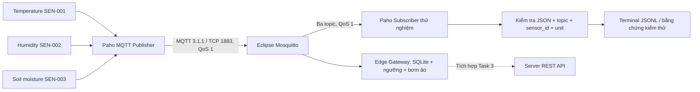

# Task 2 — Mosquitto và truyền dữ liệu MQTT

## 1. Mục tiêu và phạm vi

Mosquitto là broker trung gian: publisher gửi dữ liệu vào topic; broker chuyển cho subscriber đã đăng ký topic đó. Paho MQTT là thư viện Python kết nối với broker. Sensor Simulator dùng lại mô hình sinh dữ liệu và JSON schema của Task 1.

Phần MQTT hoàn thành đường truyền Sensor → broker → subscriber thử nghiệm. [Task 2.1 — Edge Gateway](edge.md) kiểm tra/phân loại dữ liệu, lưu SQLite, tạo cảnh báo, điều khiển bơm ảo và giám sát ONLINE/STALE/OFFLINE mà không cần Server. Subscriber thử nghiệm vẫn chỉ xem dữ liệu; chạy `edge-gateway/main.py` để lưu và xử lý. Đồng bộ HTTP lên Server sẽ được tích hợp với Task 3.



| Topic | sensor_id | unit |
|---|---|---|
| `farm/sensors/temperature` | `SEN-001` | `C` |
| `farm/sensors/humidity` | `SEN-002` | `%` |
| `farm/sensors/soil_moisture` | `SEN-003` | `%` |

MQTT tạo topic khi có publish/subscribe; không cần tạo topic thủ công trong Mosquitto. Danh tính và đơn vị được lấy từ `simulator_config.yaml`; tên ba topic cố định theo yêu cầu.

Payload giữ nguyên sáu trường Task 1:

```json
{"event_id":"EVT-EXAMPLE001","sensor_id":"SEN-001","timestamp":"2026-11-10T10:00:00Z","sequence":1,"value":29.5,"unit":"C"}
```

`timestamp` là thời điểm đo UTC. Subscriber bọc payload vào trường `event`, bổ sung `topic`, `qos`, `received_at` để quan sát; không thay đổi payload truyền trên MQTT. Sequence tăng theo từng cảm biến trong một lần chạy và khởi động lại từ 1 khi chạy lại tiến trình, theo hành vi Task 1.

## 2. Các file

- `infrastructure/docker-compose.yml`: chạy Mosquitto, volume, healthcheck.
- `infrastructure/mosquitto/mosquitto.conf`: listener, persistence, log, giới hạn QoS.
- `sensor-simulator/mqtt_common.py`: topic, tham số và cấu hình client.
- `sensor-simulator/mqtt_publisher.py`: publish, đợi xác nhận, log lỗi và kết nối lại.
- `sensor-simulator/main.py`: chạy cả ba cảm biến hoặc một cảm biến, demo chuyển chế độ.
- `sensor-simulator/mqtt_subscriber.py`: nhận và kiểm tra dữ liệu.
- `tests/test_mqtt.py`: unit tests và kiểm thử broker thực.

## 3. Cài đặt và chạy

Yêu cầu: Python 3.12+ và Docker Engine/Compose, hoặc Docker Desktop đang chạy Linux containers. Chạy lệnh từ thư mục gốc repository.

Linux / Ubuntu / Mint:

```bash
python3 -m venv .venv
source .venv/bin/activate
python -m pip install -r sensor-simulator/requirements.txt
```

Windows PowerShell (không cần sửa execution policy):

```powershell
python -m venv .venv
.\.venv\Scripts\python.exe -m pip install -r sensor-simulator/requirements.txt
```

Các lệnh `python` bên dưới giả định đã kích hoạt `.venv`. Với PowerShell chưa kích hoạt, thay `python` bằng `.\.venv\Scripts\python.exe` ở từng terminal.

Khởi động và kiểm tra broker:

```bash
docker compose -f infrastructure/docker-compose.yml up -d --wait mosquitto
docker compose -f infrastructure/docker-compose.yml ps
docker compose -f infrastructure/docker-compose.yml logs --tail 30 mosquitto
```

Mong đợi service `mosquitto` có trạng thái `healthy`. Dùng `mosquitto_sub`/`mosquitto_pub` ngay trong image nên không cần cài Mosquitto lên máy host.

Terminal A — kiểm tra TCP/MQTT thuần:

```bash
docker compose -f infrastructure/docker-compose.yml exec -T mosquitto mosquitto_sub -h 127.0.0.1 -t farm/test -q 1 -C 1 -W 15 -v
```

Terminal B — chạy trong vòng 15 giây:

```bash
docker compose -f infrastructure/docker-compose.yml exec -T mosquitto mosquitto_pub -h 127.0.0.1 -t farm/test -m mqtt-ok -q 1
```

Terminal A phải hiện `farm/test mqtt-ok`. Sau đó bắt đầu nhận telemetry bằng một trong hai cách:

```bash
# Cách 1: Python, kiểm tra payload và ghi riêng thời điểm nhận
python sensor-simulator/mqtt_subscriber.py

# Cách 2: mosquitto_sub, hiển thị nguyên topic và payload
docker compose -f infrastructure/docker-compose.yml exec -T mosquitto mosquitto_sub -h 127.0.0.1 -t "farm/sensors/+" -q 1 -v
```

Terminal khác — publish ba cảm biến, mỗi cảm biến ba bản đo:

```bash
python sensor-simulator/mqtt_publisher.py --interval 1 --count 3
# Tương đương:
python sensor-simulator/main.py --interval 1 --count 3
```

Mong đợi tổng cộng 9 sự kiện với đủ ba topic; mỗi cảm biến có sequence 1, 2, 3. Log publisher có `MQTT CONNECTED`, `MQTT PUBLISHED`. Subscriber Python hiện log `MQTT SUBSCRIBED` và từng dòng JSON chứa `topic`, `qos: 1`, `received_at`, `event`.

Bỏ `--count` để chạy liên tục; bỏ `--interval` để dùng chu kỳ mặc định 10 giây. Nhấn Ctrl+C để dừng. Chạy từng cảm biến qua MQTT:

```bash
python sensor-simulator/main.py --sensor temperature --interval 1
python sensor-simulator/main.py --sensor humidity --interval 1
python sensor-simulator/main.py --sensor soil_moisture --interval 1
```

Chạy ba lệnh trong ba terminal nếu muốn dừng độc lập từng publisher. Các file `temperature.py`, `humidity.py`, `soil_moisture.py` vẫn là CLI terminal của Task 1; dùng `main.py --sensor ...` để publish MQTT.

## 4. Cấu hình và quyết định kỹ thuật

| Tham số | Mặc định | Ý nghĩa |
|---|---|---|
| `--host` / `MQTT_HOST` | `127.0.0.1` | Địa chỉ broker |
| `--port` / `MQTT_PORT` | `1883` | Cổng TCP |
| `--qos` / `MQTT_QOS` | `1` | 0 hoặc 1; dùng 1 khi nghiệm thu |
| `--interval` | `10` giây từ YAML | Chu kỳ của cảm biến |
| `--mode` | `NORMAL` | NORMAL, ANOMALY hoặc OFFLINE |
| `--count` | liên tục | Số chu kỳ mỗi cảm biến, kể cả OFFLINE |
| `--terminal` | tắt | Chạy Task 1 không kết nối broker |
| Subscriber `--duration` | liên tục | Dừng sau N giây, tính từ lúc subscribe thành công |

Tham số CLI ghi đè biến môi trường. Nếu sau này đóng gói client vào cùng Compose network, dùng hostname `mosquitto`, cổng `1883`; `127.0.0.1` trong một container là chính container đó.

`mosquitto.conf`:

- `listener 1883 0.0.0.0`: nhận TCP trong container; Compose chỉ ánh xạ host loopback `127.0.0.1:1883`.
- `allow_anonymous true`: demo cục bộ không tài khoản/TLS. Trước khi mở ra LAN/Internet cần cấu hình authentication, ACL và TLS.
- `persistence true`: lưu trạng thái broker trong volume `mosquitto_data`, không phải cơ sở dữ liệu lịch sử telemetry.
- `log_dest stdout`: quan sát bằng `docker compose logs`; log kết nối giúp ghi nhận mất kết nối.
- `max_qos 1`: tối đa QoS 1. Healthcheck publish vào `farm/healthcheck`, nằm ngoài ba topic telemetry.

Paho dùng MQTT 3.1.1, API callback v2 và background network loop. QoS 1 là giao ít nhất một lần; publisher đợi PUBACK trước khi ghi `PUBLISHED`. PUBACK xác nhận broker đã nhận, không xác nhận Edge đã ghi xuống SQLite. QoS 1 có thể giao trùng: Edge/Server cần chống trùng bằng `event_id` ở task tiếp theo.

Telemetry gửi `retain=False`, client dùng clean session và client ID riêng. Subscriber mới không nhận lại bản đo cuối làm dữ liệu hiện tại; subscriber thử nghiệm cũng từ chối telemetry có retained flag. Không publish bản đo thay thế cho cảm biến OFFLINE. Bản tin đã gửi trước lúc dừng vẫn có thể tới muộn hoặc giao lại; kiểm tra `event_id` và thời điểm đo để phân biệt, không coi đó là bản đo mới.

## 5. Kiểm tra OFFLINE và mất kết nối

### Dừng một cảm biến

Chạy subscriber trước, rồi:

```bash
python sensor-simulator/main.py --demo --interval 1
```

Demo có 4 pha, mỗi pha 2 chu kỳ: tất cả NORMAL → nhiệt độ ANOMALY → humidity OFFLINE → tất cả NORMAL. Bình thường subscriber thử nghiệm nhận 22 sự kiện: temperature 8, humidity 6, soil_moisture 8. Trong pha OFFLINE không có bản đo humidity mới, hai topic còn lại vẫn gửi. Dữ liệu ANOMALY giữ nguyên schema dù giá trị có thể vượt dải đo; Edge mở rộng sẽ đưa giá trị ngoài dải vật lý vào quarantine, nên số bản ghi hợp lệ trong SQLite có thể ít hơn 22.

Hoặc chạy từng cảm biến trong ba terminal rồi Ctrl+C ở humidity; hai topic còn lại tiếp tục. Subscriber không tự tạo bản đo, không lặp dữ liệu cũ. Chạy `--sensor humidity --mode OFFLINE --count 3 --interval 1` không phát bản đo nào.

### Dừng và khởi động lại broker

Để subscriber và publisher chạy liên tục rồi ở terminal khác:

```bash
docker compose -f infrastructure/docker-compose.yml stop mosquitto
# Quan sát log khoảng 5–10 giây rồi:
docker compose -f infrastructure/docker-compose.yml start mosquitto
```

Mong đợi `DISCONNECTED`, `CONNECT_FAILED`, `SKIPPED_DISCONNECTED`; sau khi broker trở lại có `CONNECTED`/`SUBSCRIBED` và nhận lại đủ ba topic. Paho tự kết nối lại với backoff 1 đến 10 giây. Keepalive là 15 giây; lỗi mạng im lặng có thể cần thêm thời gian để phát hiện. Client chờ tối đa 10 giây khi khởi động; broker chưa sẵn sàng thì thoát mã 1 với thông báo lỗi.

Giới hạn cần trình bày khi bảo vệ:

- Lúc client biết broker đang ngắt, bản đo mới bị bỏ qua và ghi `SKIPPED_DISCONNECTED`; không lưu đệm sensor xuống đĩa.
- Mất kết nối trong lúc publish hoặc quá hạn PUBACK là trạng thái chưa chắc chắn (`NOT_CONFIRMED`/`ACK_TIMEOUT`); Paho có thể gửi lại bản tin QoS 1 còn trong RAM sau kết nối lại. Giới hạn queue client là 100 bản tin.
- Dừng tiến trình publisher làm mất queue RAM. QoS 1 không đảm bảo mọi bản đo vượt qua thời gian broker ngừng hoạt động.
- Khi Server không hoạt động nhưng broker vẫn chạy, [Edge mở rộng](edge.md) vẫn lưu SQLite, tạo cảnh báo và điều khiển bơm ảo. Đã có kiểm thử cục bộ này; đồng bộ phục hồi lên Server chưa được triển khai.

## 6. Kiểm thử tự động và lưu bằng chứng

Không cần broker cho unit tests:

```bash
python -m pytest tests/test_simulator.py tests/test_mqtt.py -v
```

Kiểm thử thật, bao gồm quyền dừng/khởi động lại broker demo đang chạy (không chạy song song với phiên demo khác):

Linux:

```bash
RUN_MQTT_INTEGRATION=1 RUN_MQTT_RESTART=1 MQTT_EVIDENCE_PATH=docs/mqtt-evidence.jsonl python -m pytest tests/test_simulator.py tests/test_mqtt.py -v --log-cli-level=INFO
```

PowerShell:

```powershell
$env:RUN_MQTT_INTEGRATION='1'
$env:RUN_MQTT_RESTART='1'
$env:MQTT_EVIDENCE_PATH='docs/mqtt-evidence.jsonl'
.\.venv\Scripts\python.exe -m pytest tests/test_simulator.py tests/test_mqtt.py -v --log-cli-level=INFO 2>&1 | Tee-Object -FilePath docs/mqtt-test-output.txt
```

Không bật `RUN_MQTT_RESTART` thì test restart được bỏ qua. Không bật `RUN_MQTT_INTEGRATION` thì cả ba integration tests được bỏ qua. Test restart luôn cố khởi động lại broker trong bước dọn dẹp sau khi dừng.

Các test xác minh routing, QoS, JSON/schema, timestamp có múi giờ, sai sensor/unit, NaN, OFFLINE, PUBACK lỗi, đăng ký lại subscription, nhận đủ ba topic, chạy CLI thật và không replay bản đo cuối cho subscriber mới. Bằng chứng thực tế nằm ở [test-results.md](test-results.md), [JSONL nhận được](mqtt-evidence.jsonl) và [log pytest](mqtt-test-output.txt).

## 7. Lỗi thường gặp và dừng hệ thống

- `Cannot connect to Docker daemon` / lỗi named pipe: mở Docker Desktop hoặc khởi động Docker Engine, đợi engine sẵn sàng, kiểm tra `docker info`.
- `Connection refused`: kiểm tra `docker compose ... ps`, log Mosquitto, host/port và việc broker đã chạy.
- Cổng 1883 đã dùng: dừng broker cũ hoặc đổi host mapping và truyền `--port` tương ứng cho cả hai client.
- Không thấy dữ liệu: chạy subscriber trước publisher; kiểm tra đúng topic và không chạy OFFLINE. Không dùng retained telemetry để che việc thiếu bản đo.
- `MQTT INVALID`: xem log, kiểm tra đủ sáu trường, ID/đơn vị đúng topic và timestamp có timezone.
- Nếu từng tự publish retained message lên topic, xóa từng bản retained trước khi nghiệm thu, ví dụ: `docker compose -f infrastructure/docker-compose.yml exec -T mosquitto mosquitto_pub -h 127.0.0.1 -t farm/sensors/temperature -r -n`. Lặp lại với hai topic khác nếu có.
- Log `PUBLISHED` nhưng không có dữ liệu lịch sử ở subscriber mới là hành vi mong đợi khi `retain=False` và clean session.

```bash
docker compose -f infrastructure/docker-compose.yml down
```

Lệnh trên dừng/xóa container và network của Compose, giữ volume broker. Không dùng `down -v` nếu cần giữ trạng thái broker.

Tài liệu tham khảo chính thức: [Mosquitto Docker](https://github.com/eclipse-mosquitto/mosquitto/blob/master/docker/generic/README.md), [mosquitto.conf](https://mosquitto.org/man/mosquitto-conf-5.html), [Paho Python client API](https://eclipse.dev/paho/files/paho.mqtt.python/html/client.html).
